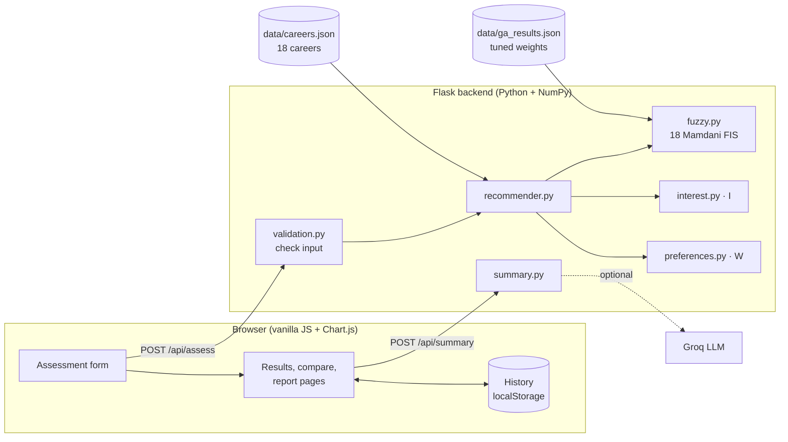
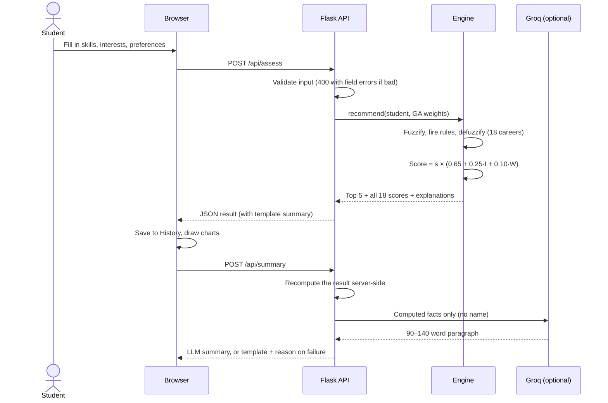
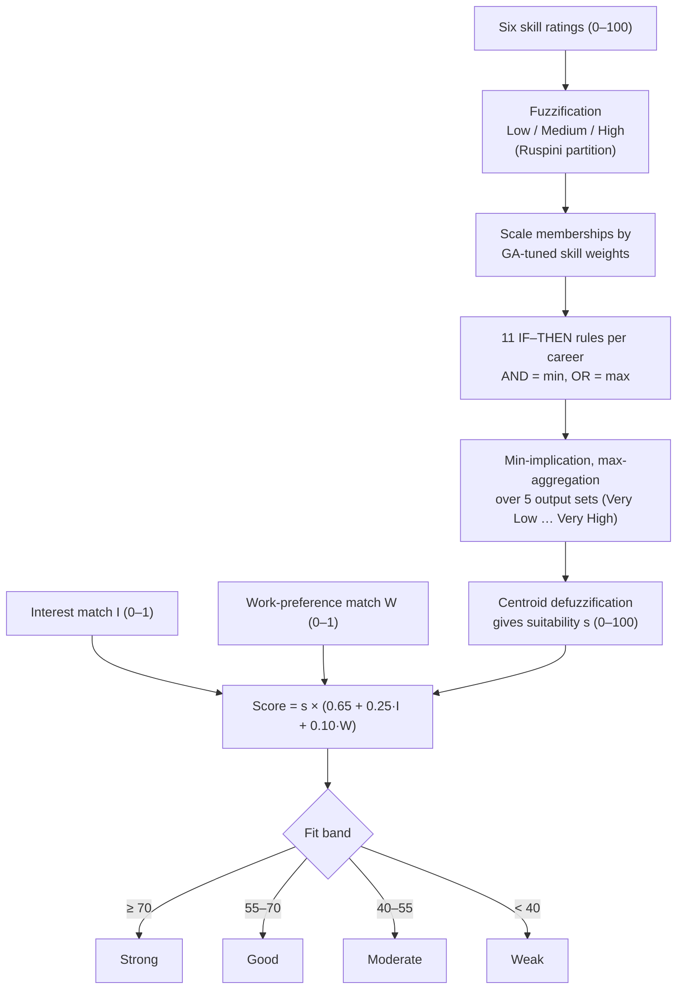
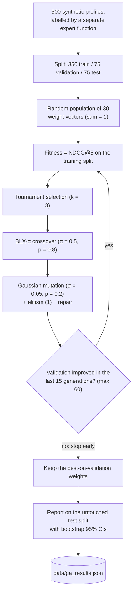
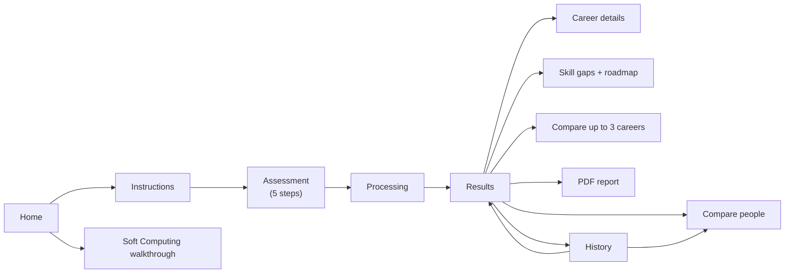
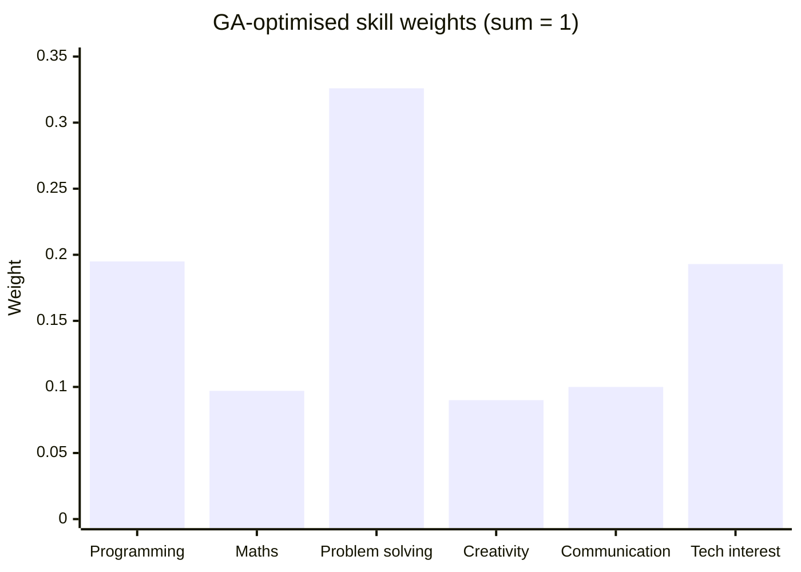
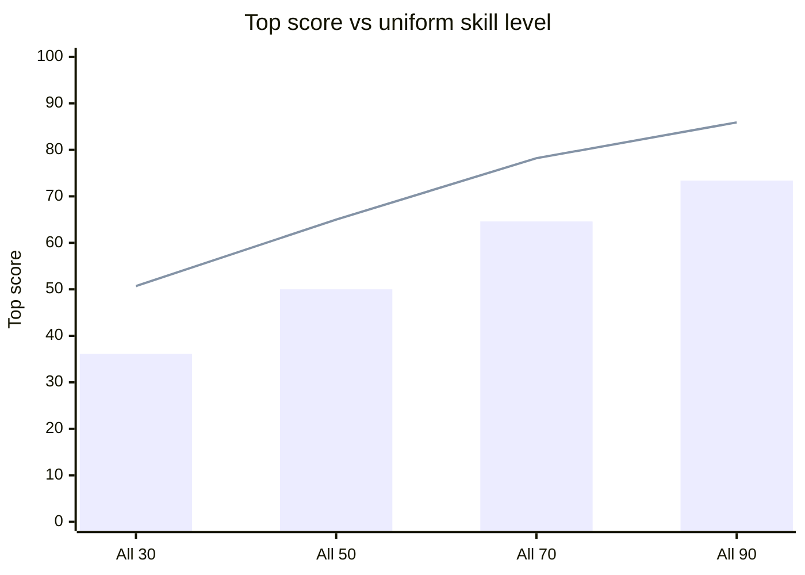

# CareerCompass: AI-Based Career Recommendation System (Soft Computing)

CareerCompass helps a university student explore which careers fit them. It is an MCA Soft Computing project. The point is to show how **fuzzy logic** and a **genetic algorithm** can turn vague, self-reported answers ("I'm fairly good at maths") into a ranked, explained list of careers.

The student does three things:

1. Rates six skills from 0 to 100: programming, mathematics, problem solving, creativity, communication and technical interest.
2. Picks and ranks the subject areas they are interested in.
3. Optionally gives work preferences (work type, environment, activity, appetite for advanced maths).

The app then scores all 18 careers and returns the **top 5**. Each one comes with a fit band, a score breakdown, the fuzzy rules that fired, the skills to improve and a learning roadmap.

> Recommendations are guidance for career exploration, not a guarantee. Career targets and work profiles are model assumptions, not official industry standards.

## What you can do in the app

| Page | What it shows |
|---|---|
| **Assessment** | A five-step form: profile, skill ratings, interests, work preferences, review |
| **Results** | Top 5 careers with fit bands (Strong / Good / Moderate / Weak), score breakdown charts, fired rules, and a summary (template or LLM-written) |
| **Career details / Skill gaps** | One career's profile, your skills vs its target on a radar chart, and a step-by-step roadmap |
| **Compare careers** | Up to **three** careers side by side (defaults to your top 3): score, fit, rank, fuzzy suitability, interest and preference match, and gap per skill |
| **Compare people** | Any **two people** from the current result and this browser's history: each person's top 5, shared careers, skill radar, rating differences and scores for all 18 careers. If nobody else is saved, it says *"No other data available to compare"* |
| **History** | Past results saved in this browser, a demo loader (5 profiles), and JSON export |
| **PDF report** | A printable report of the inputs, top 5 and roadmaps |
| **Soft Computing** | A walkthrough for the viva: membership functions, the rule base, GA convergence, evaluation, and a live playground |

## How it works

### The big picture



The genetic algorithm **never runs during a request**. It runs offline (`python run_ga.py`), and the app loads the saved weights at startup.

### What happens when a student submits



### Scoring pipeline for one career



Interest and preferences can only **scale** the fuzzy suitability, so the score never exceeds *s*. Without work preferences, their 0.10 share is redistributed pro rata.

### Offline weight tuning with the genetic algorithm



### Page map



### Learned skill weights

The GA found that problem solving matters most, followed by programming and technical interest:



### How the score responds to skill level

The same profile (one matching interest) at four uniform skill levels. Bars are v2, the line is v1:



In v1 the interest term was *added*, so an average student scored 65. In v2 it *scales* the score, so weak skills stay weak. See `DESIGN.md` for every design decision and `CHANGELOG.md` for what changed.

## Setup and run (Windows; macOS/Linux shown in comments)

**Quick start (Windows):** double-click `run.bat`. On the first run it creates `.venv` and installs the requirements. Then it starts the server and opens http://127.0.0.1:5000 in your browser. Close the window to stop the server. It needs Python 3.11+ on PATH.

Manual setup:

```bash
python -m venv .venv
.venv\Scripts\activate            # macOS/Linux: source .venv/bin/activate
pip install -r requirements.txt

python app.py                     # open http://127.0.0.1:5000
```

Optional LLM summary: copy `.env.example` to `.env` and set `GROQ_API_KEY` (free key at console.groq.com). The default model is `openai/gpt-oss-120b`; override it with `GROQ_MODEL`. Without it, or when offline, the template summary is used and the page says so. Only computed scores and skill names are sent; the display name is never sent.

Other commands:

```bash
python -m pytest tests -q         # 63 tests: FIS, GA, statistics, dataset, recommender, API
python run_ga.py                  # re-run the GA experiment → data/ga_results.json (~1–2 min incl. 5-seed check)
python demo_profiles.py           # the 5 demonstration profiles and their top 5
```

Chart.js 4.4.1 is bundled in `static/vendor/`, so the demo works offline.

## Project structure

```
app.py                 Flask API + serves the frontend
run_ga.py              offline GA experiment (never runs during a request)
demo_profiles.py       five demonstration profiles (also served to "Load demo history")
engine/
  data.py              dataset loading
  fuzzy.py             membership functions, 11-rule template, vectorised Mamdani inference
  interest.py          interest match I_c
  preferences.py       work-preference match W_c
  recommender.py       score, fit bands, ranking, explanations, skill gaps, roadmap, template summary
  summary.py           optional Groq summary with template fallback
  ga.py                GA operators, validation-based early stopping, NDCG@5 / Precision@5
  stats.py             bootstrap confidence intervals
  reference.py         500 SYNTHETIC profiles + separate expert labelling function
  validation.py        server-side input validation
data/
  careers.json         18 careers (targets, work profiles, roadmap steps = model assumptions)
  reference_profiles.json   synthetic profiles (generated by run_ga.py)
  ga_results.json      GA history, weights, evaluation with CIs (loaded at startup)
static/                HTML, CSS, vanilla JS (app.js, sc.js), Chart.js
tests/                 pytest suite
```

## API

| Method | Path | Purpose |
|---|---|---|
| POST | `/api/assess` | Validate the input and return the top 5, fit bands, breakdowns, explanations, skill gaps, roadmap, fired rules, worked example and template summary |
| POST | `/api/summary` | Same input; returns an LLM summary (Groq) or the template fallback with a reason |
| POST | `/api/playground` | `{skills, career_id, weights: "optimized"\|"equal"}` → one career's FIS step by step |
| GET | `/api/demo-profiles` | The five demonstration profiles |
| GET | `/api/meta` | Skill, interest and work-preference options; whether an LLM is configured |
| GET | `/api/careers`, `/api/careers/<id>` | Career list and one career profile |
| GET | `/api/analysis` | Membership curves, the rule template and full rule base, GA history, weights, evaluation with CIs and robustness |

Example request body for `/api/assess`:

```json
{"display_name": "optional",
 "skills": {"programming": 80, "mathematics": 60, "problem_solving": 85,
            "creativity": 40, "communication": 55, "technical_interest": 90},
 "interests": ["software", "cloud"],
 "work_preferences": {"work_type": "technical", "environment": "mixed"}}
```

## Score calibration (v1 → v2)

| Profile (one matching interest) | v1 top score | v2 top score |
|---|---|---|
| Every skill 30 | 50.7 | 36.1 (Weak) |
| Every skill 50 | 65.0 | 50.0 (Moderate) |
| Every skill 70 | 78.2 | 64.6 (Good) |
| Every skill 90 | 85.9 | 73.4 (Strong) |
| Technology-oriented demo | 84.7 | 74.4 (Strong) |
| Balanced 60s, mixed interests | 59.6 | 56.9 (Good) |

In v1 the interest term was *added* (up to 30 points), so an average skill profile scored 65. In v2 it *scales* the fuzzy suitability, so the score never exceeds *s*.

## GA results (`data/ga_results.json`, seed 42, 95% bootstrap CIs)

| Split | n | Baseline NDCG@5 | GA NDCG@5 | Difference (paired) | Baseline P@5 | GA P@5 |
|---|---|---|---|---|---|---|
| Training | 350 | 0.8546 [0.8385, 0.8706] | 0.8699 [0.8567, 0.8827] | +0.0153 [+0.0073, +0.0235] | 0.7903 [0.7709, 0.8097] | 0.8040 [0.7857, 0.8223] |
| Validation (model selection) | 75 | 0.8565 [0.8233, 0.8855] | 0.8666 [0.8322, 0.8956] | +0.0101 [-0.0037, +0.0255] | 0.7733 [0.7280, 0.8160] | 0.7867 [0.7440, 0.8293] |
| **Test (untouched)** | 75 | 0.8470 [0.8127, 0.8792] | 0.8590 [0.8321, 0.8859] | +0.0121 [-0.0047, +0.0296] | 0.7893 [0.7467, 0.8320] | 0.8000 [0.7627, 0.8373] |

- Selected chromosome: generation 22 (early stop: True). Weights: programming 0.195, mathematics 0.097, problem_solving 0.326, creativity 0.090, communication 0.100, technical_interest 0.193.
- Robustness over 5 GA seeds: test NDCG@5 = 0.8604 ± 0.0035 (mean ± SD).

**How to read this.** The GA improves the training fitness, and the improvement is significant there. On the untouched test split, the difference is +0.0121 with a 95% CI that **includes zero**, so it is **not a statistically significant improvement** over equal weights. Present it as "a small, consistent tendency", not as an accuracy gain. Agreement is lower than with an additive score on the same 500 profiles (about 0.86 vs 0.90). The v2 score is multiplicative, while the expert labels stay additive. The model now shares less of its formula with the labels, so there is less circular agreement.

## Known limitations

- **Synthetic evaluation.** The reference labels come from our own expert function (target-weighted unmet requirement plus interest match). The evaluation measures agreement with our assumptions, not real-world accuracy. A real survey test set would be the next step.
- **Shared interest term.** The model and the reference labels both use the interest match, which raises agreement for both baseline and GA weights.
- **Shared rule template.** Careers with the same primary pair (for example Cloud Engineer and Network Engineer) get similar *s* and are separated mainly by the secondary skill, interests and preferences.
- **Rule base deviates from the specification.** It has 198 rules rather than the 15–25 suggested (see DESIGN.md).
- Self-reported ratings are subjective. The work profiles and roadmap steps are simplified assumptions.
- **History is per browser.** It is stored in `localStorage`, so another computer starts empty (use "Load demo history" for a demo). Nothing is stored on the server, so "Compare people" only sees assessments saved in the same browser.
- **LLM summary** depends on an external service. It falls back to the template on any failure.
- **Mobile layout** was checked with headless Edge at 390 px, not on a real phone. Wide tables scroll horizontally.
